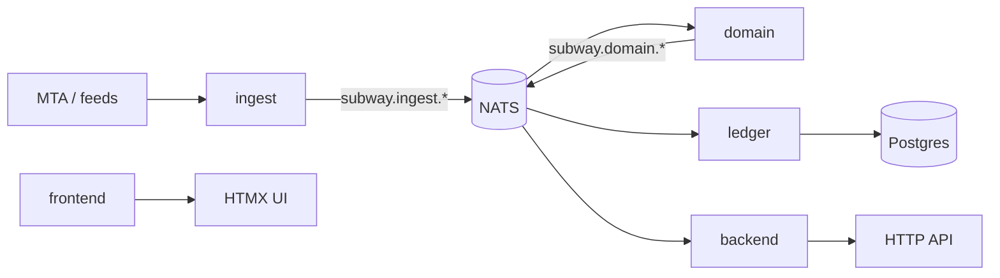

# subway-market

Trading stack using NYC subway signals for prediction markets. Shared infrastructure spine — lane apps communicate over NATS (`subway.*` subjects) via [`dto`](crates/dto) + [`transport`](crates/transport).

## Architecture



| Path | Purpose |
| ---- | ------- |
| [`apps/`](apps/) | Binaries — `ingest`, `domain`, `ledger`, `backend`, `frontend` (`*-app` packages) |
| [`apps/contracts/`](apps/contracts/) | Foundry Solidity (Monad / anvil) — not a Cargo member |
| [`crates/`](crates/) | Lane libs + shared `dto` / `transport` / `db` / `chain` |
| [`justfile`](justfile) | Dev session (`up`, `start`, `down`, …) |
| [`docker-compose.yml`](docker-compose.yml) | Local NATS + Postgres |
| [`AGENTS.md`](AGENTS.md) | Lane ownership + parallel agent rules |

## Dependencies

- **Rust** — `cargo` (workspace `rust-version = 1.94`)
- **Docker** — Docker Compose v2 (`docker compose`)
- **[just](https://github.com/casey/just)** — task runner
- **Foundry** (optional) — `forge` in `apps/contracts`

Copy [`.env.example`](.env.example) → `.env` to override `NATS_URL`, `DATABASE_URL`, or `RUST_LOG`.

## How to run

```bash
just up      # once — compose up, cargo build, migrate schema
just start   # bus apps + lnav (q / Ctrl-C stops apps)
just logs    # re-open lnav while apps keep running
just observe # TUI over ledger DB (separate terminal)
just down    # stop apps + docker compose down (Postgres volume kept)
just check   # cargo check --workspace (no docker required)
```

| Command | What it does |
| ------- | ------------ |
| `just up` | Start NATS + Postgres, `cargo build --workspace`, run `ledger-migrate` |
| `just start` | Rebuild if needed; start bus apps with ready gates; open **lnav** |
| `just logs` | Re-open lnav on bus logs (apps already running) |
| `just observe` | Glance TUI over `tracked_trains` (not on bus) |
| `just start-with-frontend` | Bus apps + frontend, then lnav including `frontend.log` |
| `just down` | Kill apps, `docker compose down` (volume kept) |
| `just reset` | Wipe logs + Docker volumes, then `just up` (type `reset` to confirm) |
| `just check` | `cargo check --workspace` |
| `just test` | `cargo test --workspace` |

Solo lane: `just ingest`, `just domain`, `just ledger`, `just backend`, `just frontend`, `just observe`.

Ops detail: [`docs/system.md`](docs/system.md). lnav format pack: [`lnav/`](lnav/).

## Parallel development

See [`AGENTS.md`](AGENTS.md). Each lane owns `crates/<lane>` + `apps/<lane>`. Serialize edits on shared crates (`dto`, `transport`, `db`) and ops files.
