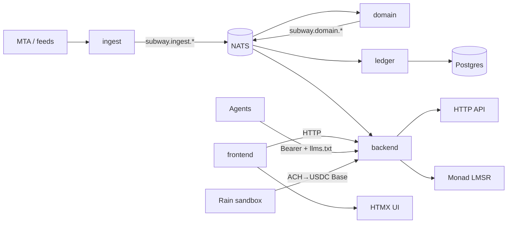

# subway-market

Agentic prediction market on whether a randomly selected MTA train is **early or late** (binary only — no on-time). Humans fund bankroll and set strategy; agents trade via HTTP + [`llms.txt`](crates/backend). Rain.xyz on-ramps ACH→USDC; LMSR settlement in USDC on Monad. Platform signs all chain txs.

Go-time LMSR / trading / funding landed on integration branch `cheese` and is merged into `main`.

Shared spine: lane apps talk over NATS (`subway.*`) via [`dto`](crates/dto) + [`transport`](crates/transport). Ledger is sole Postgres writer.

## Architecture



| Path | Purpose |
| ---- | ------- |
| [`apps/`](apps/) | Binaries — `ingest`, `domain`, `ledger`, `backend`, `frontend`, `observe` (`*-app`) |
| [`apps/contracts/`](apps/contracts/) | Foundry Solidity (Monad / anvil) — not a Cargo member |
| [`crates/`](crates/) | Lane libs + shared `dto` / `transport` / `db` / `chain` |
| [`tests/e2e/`](tests/e2e/) | Full-stack E2E harness |
| [`justfile`](justfile) | Dev session (`up`, `start`, `anvil`, `e2e`, …) |
| [`docker-compose.yml`](docker-compose.yml) | Local NATS + Postgres |
| [`AGENTS.md`](AGENTS.md) | Lane ownership + agent rules |

**Stack:** Rust Cargo workspace (lanes), Foundry contracts, NATS, Postgres (Diesel), Axum + HTMX + askama frontend. Frontend calls backend HTTP only (no Diesel/NATS in frontend).

## Dependencies

- **Rust** — `cargo` (workspace `rust-version = 1.94`)
- **Docker** — Docker Compose v2 (`docker compose`)
- **[just](https://github.com/casey/just)** — task runner
- **Foundry** — `forge` / `anvil` in `apps/contracts` (local deploy + E2E)

## Quick start

```bash
cp .env.example .env
# edit FUNDING_MODE, keys, contract addresses as needed

just anvil              # terminal 1 — anvil @ 127.0.0.1:8545
just deploy-local       # MockUSDC + SubwayMarket; writes USDC_ADDRESS / SUBWAY_MARKET_ADDRESS into .env
just up                 # docker Postgres+NATS, cargo build, migrate
just start-with-frontend  # bus apps + frontend + lnav
```

Defaults after `cp .env.example .env`: `FUNDING_MODE=local`, public anvil #0 as `PLATFORM_SIGNER_KEY`.

### Ports

| Service | Host port |
| ------- | --------- |
| Postgres | `5433` |
| NATS client | `4223` (monitor `8223`) |
| Anvil | `8545` |
| Backend | `8080` |
| Frontend | `3000` |

### Session commands

```bash
just up                   # once — compose up, cargo build, migrate
just start                # bus apps + lnav (q / Ctrl-C stops apps)
just start-with-frontend  # bus + frontend + lnav
just logs                 # re-open lnav while apps keep running
just observe              # read-only DB TUI (separate terminal)
just down                 # stop apps + docker compose down (volume kept)
just check / just test    # workspace check / test
```

| Command | What it does |
| ------- | ------------ |
| `just up` | Start NATS + Postgres, `cargo build --workspace`, `ledger-migrate` |
| `just anvil` | Host anvil on `127.0.0.1:8545` |
| `just deploy-local` | Deploy MockUSDC + SubwayMarket; paste/update `.env` addresses |
| `just start` | Bus apps with ready gates + **lnav** |
| `just start-with-frontend` | Bus + frontend + lnav |
| `just e2e-unit` | `cargo check/test -p e2e` (no stack) |
| `just e2e` | Full E2E 1→2→3 (`E2E_FULL=1`) |
| `just down` | Kill apps, `docker compose down` (volume kept) |
| `just reset` | Wipe logs + Docker volumes, then `just up` |

Solo lane: `just ingest`, `just domain`, `just ledger`, `just backend`, `just frontend`, `just observe`.

Ops detail: [`docs/system.md`](docs/system.md). Go-time / funding design: [`docs/go_time_prompt.md`](docs/go_time_prompt.md).

## Funding modes

One funding abstraction; flip with `FUNDING_MODE` — same binary, no forked code paths.

| Mode | Bankroll | Chain | Rain |
| ---- | -------- | ----- | ---- |
| `local` (default) | Seeded Postgres (`SEED_BANKROLL_USDC`) | Anvil + MockUSDC | Ignored |
| `testnet` | Rain sandbox ACH→USDC | Monad testnet via `MONAD_RPC_URL` | Requires `RAIN_*` |

Testnet Rain vars (see [`.env.example`](.env.example)): `RAIN_API_BASE_URL`, `RAIN_TEAM_ID`, `RAIN_USER_ID`, `RAIN_API_KEY`, `RAIN_COLLATERAL_CONTRACT_ID`, `RAIN_DESTINATION_ADDRESS` (compliance destination on Base — not anvil #0 / platform signer). Optional: `RAIN_DESTINATION_RAIL` (default `base`), `RAIN_SANDBOX_CREDIT_ON_SIMULATE`.

### Honest notes (Path C interim)

- Rain sandbox rails are Base/Ethereum/etc — **no Monad**. ACH→USDC lands on Base (`RAIN_DESTINATION_ADDRESS`).
- Go-time Path C: Base settle + Postgres bankroll credit + **interim treasury mirror** (MockUSDC mint 1:1 on anvil / Circle faucet or CCTP later on Monad). Not a real bridge yet; CCTP Base→Monad is the intended follow-on.
- `RAIN_SANDBOX_CREDIT_ON_SIMULATE`: sandbox-only — credits agent bankroll right after ACH simulate succeeds so E2E/agents can trade while transfers stay `processing`. Not real ACH finality; later webhook/poll settle is idempotent (no double credit). Default on when `RAIN_API_BASE_URL` looks like sandbox/dev.

## Auth

| Who | How |
| --- | --- |
| Humans | Phantom wallet connect (frontend) → backend session. Identity only — humans do **not** sign LMSR txs. CLI/`cast` keys work for E2E (Monad = EVM). |
| Agents | `Authorization: Bearer AGENT_API_KEY` + HTTP/`llms.txt` only — never Rain or chain directly. |
| Platform | One `PLATFORM_SIGNER_KEY` signs all Monad LMSR txs (`backend` + `chain`). |

## E2E

See [`tests/e2e/README.md`](tests/e2e/README.md).

```bash
just e2e-unit   # harness unit tests, no stack
just e2e        # E2E 1–2 (local seed) then E2E 3 (Rain when RAIN_* set)
just e2e-agent  # composer-2.5 agent leg after E2E 3 handoff
```

E2E 1–2 / CI: `FUNDING_MODE=local`. Go-time acceptance E2E 3: `FUNDING_MODE=testnet` + full `RAIN_*`.

## Lane ownership

See [`AGENTS.md`](AGENTS.md). Each lane owns `crates/<lane>` + `apps/<lane>`. No cross-lane crate deps; shared surface is `dto` + `transport` (+ `db` reads). Serialize edits on `dto`, `transport`, `db`, `chain`, and ops files.
